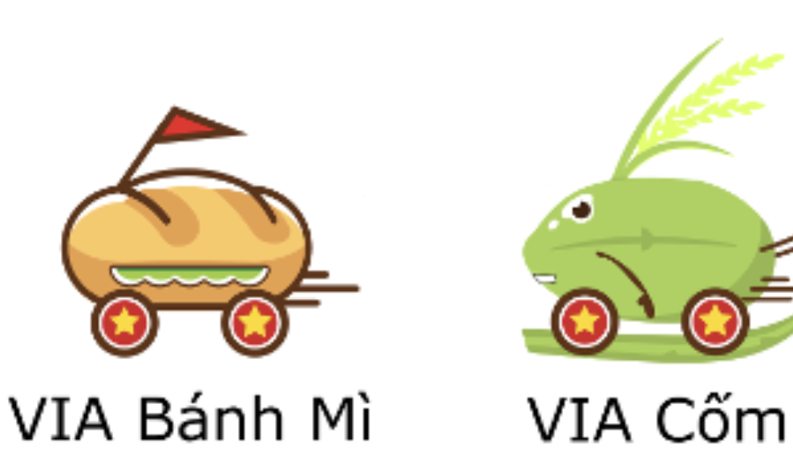
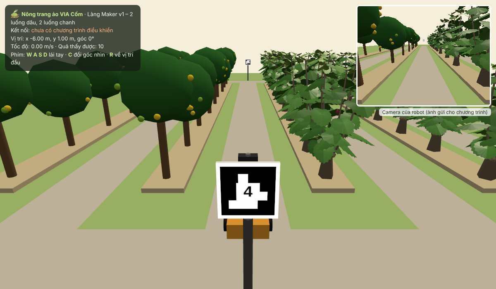

<p align="center"></p>

# VIA Cốm (VIA C) – Robot nông nghiệp mã nguồn mở của Làng Maker

**VIA Cốm** là thế hệ thứ ba của dự án [VIA – Vietnam Autonomous](https://via.makerviet.org/) do Maker Việt khởi xướng, nối tiếp VIA B (Bánh Mì). VIA B dạy robot **lái xe**; VIA Cốm đưa robot ra vườn để **làm việc thật**: đi dọc luống, nhìn cây, hái lá dâu và hái chanh.

> Từ ổ bánh mì chạy trên phố tới hạt cốm chạy trên đồng lúa: logo mới giữ bộ bánh xe ngôi sao của VIA B, thay ổ bánh mì bằng hạt cốm xanh có bông lúa.
>
> 

Repo này là nơi chung cho kiến trúc, kế hoạch, bộ dữ liệu và hệ mô phỏng của dự án.



## Chưa có robot vẫn lập trình được

Thời Physical AI, rào cản lớn nhất là phần cứng. **Nông trang ảo** chạy ngay trên trình duyệt, không cần cài đặt, không cần card đồ hoạ:

```bash
pip install websockets
python tools/run_sim.py                 # mở nông trang ảo
python examples/hello_com/drive.py      # ở cửa sổ khác: robot tự đi dọc luống
```

Nông trang ảo giữ đúng cách kết nối của giả lập VIA B, nên bài học cũ dùng lại được. Mỗi giây nó gửi 10 gói dữ liệu gồm ảnh camera, lidar, vị trí, mốc đầu luống và **nhãn quả chanh tự động** để huấn luyện AI. Chi tiết ở [docs/SIMULATION.md](docs/SIMULATION.md).

## Tài liệu

| Tài liệu | Nội dung |
| --- | --- |
| [Kiến trúc tổng thể](docs/ARCHITECTURE.md) | Các tầng phần cứng, phần mềm ROS 2, mô phỏng và dữ liệu ghép với nhau thế nào |
| [Kế hoạch 2026–2030](docs/ROADMAP-2026-2030.md) | Lộ trình 5 năm hướng tới ứng dụng thực tiễn |
| [Bộ dữ liệu](docs/DATASET.md) | Quy cách và mục tiêu của bộ dữ liệu robot AI nông nghiệp Việt Nam |
| [Mô phỏng](docs/SIMULATION.md) | Nông trang ảo, giao thức, cách nối với ROS 2 |
| [Đóng góp](CONTRIBUTING.md) | Cách tham gia |

## Cấu trúc repo

```
sim/web/        Nông trang ảo 3D chạy trên trình duyệt
sim/maps/       Bản đồ vườn (tệp JSON, tự sửa hoặc tự tạo được)
examples/       Bài "Hello Cốm!" bằng Python
tools/          Công cụ chạy giả lập và ghi dữ liệu
ros2/           Gói ROS 2 nối nông trang ảo với ROS 2
dataset/        Quy cách và mẫu của bộ dữ liệu
docs/           Kiến trúc, kế hoạch, hướng dẫn
```

## Trạng thái (11/2026)

Dự án đang ở giai đoạn khởi động. Đã có: nông trang ảo bản 0.1, bài Hello Cốm!, công cụ ghi dữ liệu, quy cách dữ liệu bản 0.1. Gói ROS 2 đã viết nhưng **chưa chạy thử trên máy có ROS 2**. Robot thật (bản 1, đế 2 bánh) đang ở bước thiết kế.

## Kế thừa từ VIA B

VIA Cốm dùng lại mạch [VIA B Bánh Mì](https://github.com/makerviet/via-docs), cách chia khối của [via-ros-2](https://github.com/makerviet/via-ros-2), ý tưởng giả lập nhẹ và bản đồ tự tạo của [via-simulation-jeep](https://github.com/makerviet/via-simulation-jeep), và cách mở dữ liệu của [via-datasets](https://github.com/makerviet/via-datasets).

## Giấy phép

Phần mềm: MIT. Tài liệu và dữ liệu: CC BY 4.0. Thiết kế phần cứng (khi công bố): CERN-OHL. Đây là đề xuất trong tài liệu định hướng, chờ Maker Việt chốt.

## Liên hệ

Maker Việt · <http://makerviet.org/> · makerviet.official@gmail.com
