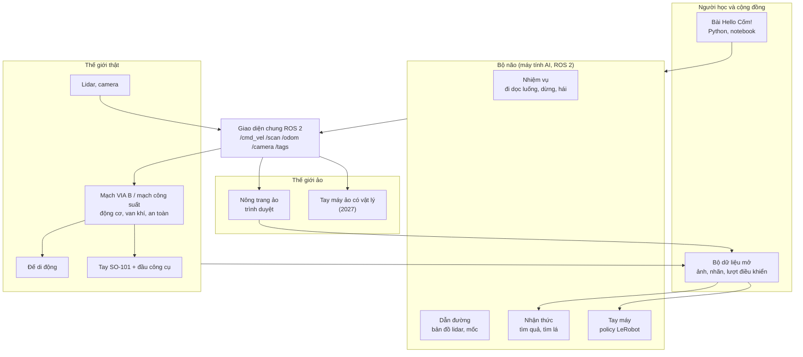
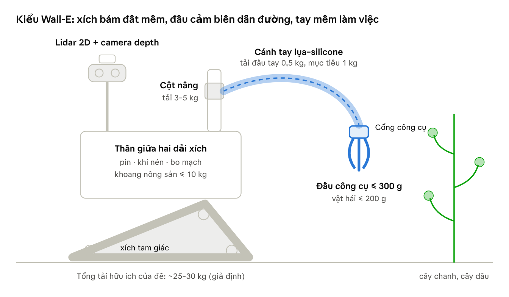

# Kiến trúc tổng thể VIA Cốm

Bản 0.1 · 22/11/2026 · Đề xuất, chờ nhóm kỹ thuật Maker Việt rà soát.

VIA Cốm được thiết kế quanh một nguyên tắc: **một giao diện, hai thế giới**. Phần mềm điều khiển nói chuyện với robot qua cùng một bộ tên gọi ROS 2, dù phía sau là nông trang ảo hay robot thật ngoài vườn. Nhờ vậy người không có robot vẫn đóng góp được, và mọi thứ được thử trên máy tính trước khi ra vườn.

## Sơ đồ tổng thể

## Năm tầng

### 1. Phần cứng

Theo bản 1 đã chốt trong tài liệu định hướng:

| Khối | Bản 1 (2026–2027) | Về sau |
| --- | --- | --- |
| Đế di động | 2 bánh chủ động + bánh tự lựa, nền cứng | 4 bánh, rồi xích nếu số đo ngoài vườn đòi hỏi |
| Cánh tay | Khung SO-101 trên cột nâng | Cánh tay mềm lụa–silicone |
| Đầu công cụ | Tay mềm 3 xúc tu có lưỡi cắt cuống; đầu tuốt lá dâu | Gieo hạt, diệt cỏ |
| Cảm biến | Lidar 2D, camera đo chiều sâu, mốc AprilTag | GPS RTK |
| Mạch điều khiển | Mạch VIA B lái động cơ | Mạch công suất VIA Cốm (thêm cổng servo nối chuỗi, kênh van khí) |
| Máy tính AI | Bo RK3588 có sẵn, hoặc NEO AI nếu kịp | NEO AI bản chính thức |

#### Mô hình robot (bản phác thảo)

Bản ghép 3D đầu tiên từ đế thật v2.0 và tay SO-101 nằm ở [HARDWARE-v0.1.md](HARDWARE-v0.1.md).

Robot gồm bốn khối, xếp theo nguyên tắc **mọi thứ nặng nằm trên đế**:

1. **Đế di động**: thân hộp khung nhôm khoảng 45 × 60 cm, chứa pin LiFePO4 12V, bơm áp, bơm chân không, van, bo mạch và khay nông sản.
2. **Cột cảm biến ("đầu")**: lidar 2D và camera đo chiều sâu đặt cao hơn tán cỏ để nhìn thấy cọc và trụ.
3. **Cột nâng**: ray trượt hành trình khoảng 40–60 cm, gánh độ cao để cánh tay không phải với xa.
4. **Cánh tay và đầu công cụ**: SO-101 ở bản 1, cánh tay mềm lụa–silicone từ bản 2; đầu công cụ cắm vào Cổng công cụ VIA.

Ngân sách tải (giả định thiết kế, cần thử thật):

| Tầng | Mang gì | Tải thiết kế |
| --- | --- | --- |
| Đế | Pin ~3 kg, khí nén ~1,5 kg, bo mạch ~1 kg, cột và tay ~4 kg, khay nông sản tối đa 10 kg | ~25–30 kg |
| Cột nâng | Cánh tay, đầu công cụ, vật hái | 3–5 kg |
| Cánh tay | Đầu công cụ và vật hái | 0,5 kg (SO-101), mục tiêu 1 kg (tay mềm) |
| Đầu công cụ | Riêng đầu tối đa 300 g | Vật hái tối đa 200 g |

#### Đế đổi được: 2 bánh, 4 bánh, xích

Cả ba kiểu đều lái bằng hai động cơ trái–phải. Mỗi bên một cụm truyền động (động cơ, hộp số, encoder) kéo 1 bánh, 2 bánh qua đai, hoặc bánh răng của dải xích. Một thân chung, đổi cụm truyền động theo giai đoạn:

| Nguyên mẫu | Mặt nền | Dùng để | Qua cửa |
| --- | --- | --- | --- |
| P1 · 2 bánh chủ động + bánh tự lựa | Nền cứng, nhà kính, lớp học | Bản đồ, dẫn đường, hai kỹ năng hái | Tự đi hết tuyến và hái được lá dâu, chanh tại điểm dừng |
| P2 · 4 bánh skid-steer | Đất nện, lối vườn khô | Đo lực kéo, độ trượt, thời gian pin thật | Chạy hết một luống thật trong ngày khô, không lạc |
| P3 · xích tam giác | Đất mềm, bùn, bờ luống | Chạy quanh năm | Chạy được sau mưa và vượt bờ luống; chỉ làm nếu số đo P2 cho thấy cần |

Bản 2 bánh dễ chúi khi tay vươn xa: đế rộng, pin đặt thấp, bánh tự lựa cả trước và sau, robot đứng yên khi hái. Kiểu xích lấy cảm hứng bố cục từ các robot hoạt hình quen thuộc nhưng không sao chép ngoại hình nhân vật.

#### Cổng công cụ VIA và các đầu công cụ thay nhanh

Mọi đầu công cụ cắm vào một **Cổng công cụ VIA** chung: khớp xoay-khoá, nguồn 12V và CAN, 2 đường khí (áp suất, chân không), vi điều khiển tự khai báo loại đầu, dây khoá liên động an toàn. Robot đổi việc trong vài phút, cộng đồng tự làm đầu mới.

| Đầu | Giai đoạn |
| --- | --- |
| Đầu quan sát (camera cận cảnh, cảm biến đất) | v0–v1 |
| Tay mềm 3 xúc tu hái quả, có lưỡi cắt cuống | v0–v1 |
| Đầu hái lá dâu | v0–v1 |
| Đầu gieo hạt | v1 |
| Đầu laser diệt cỏ (gắn dưới gầm, có váy che và khoá liên động) | v2 trở đi |

Chi tiết chuẩn cổng, từng đầu, hai bước của cánh tay và chợ đầu công cụ ở [CONG-CONG-CU.md](CONG-CONG-CU.md).

#### Bo mạch hai phần

Tách "não" và "cơ bắp" thành hai bo, để đổi đời chip AI mà không phải thiết kế lại phần công suất:

| | Não: NEO AI | Cơ bắp: mạch công suất VIA |
| --- | --- | --- |
| Chip | Rockchip RK3588 (NPU 6 TOPS), hoặc RK3399 rẻ hơn, không NPU | ESP32-S3, nâng từ ESP32 của VIA B |
| Việc | Camera, ROS 2, policy LeRobot, giọng nói tiếng Việt | Điều khiển thời gian thực, đọc cảm biến, dừng khẩn cấp |
| Động cơ | | 4 kênh DC dòng lớn có encoder và đo dòng |
| Cánh tay | | Cổng bus servo Feetech cho SO-101 |
| Khí nén | | 8 kênh MOSFET cho van và bơm |
| Đầu công cụ | | CAN, 12V và dây khoá liên động tới Cổng công cụ |
| Nguồn | Nhận 5V từ mạch công suất | Pin 12V vào, cầu chì, đo pin, hạ áp; cân nhắc 24V để giảm dòng |
| Nối với nhau | USB hoặc UART, và CAN | USB hoặc UART, và CAN |

Bản 1 dùng mạch VIA B kèm mạch rời; mạch công suất VIA Cốm làm riêng từ bản 2, vì động cơ cỡ 100 W ở 12V kéo trên 8 A, vượt sức cầu H nhỏ của VIA B. Với học sinh, riêng mạch công suất đã đủ điều khiển robot bằng tay như VIA B hiện nay; NEO AI là bước nâng cấp khi học tới AI.

### 2. Firmware

Mạch ESP32 lo việc thời gian thực: điều tốc hai bánh, đọc encoder và cảm biến nghiêng, đóng mở van, dừng khẩn cấp. Nó nhận lệnh tốc độ trái–phải từ máy tính AI. Cả ba kiểu đế (2 bánh, 4 bánh, xích) đều lái bằng hai động cơ trái–phải, nên đổi đế không phải viết lại phần mềm tầng trên.

### 3. Bộ não ROS 2

Kế thừa cách chia khối của via-ros-2 (driver, nhận thức, điều khiển tách rời), chuyển lên bản ROS 2 hỗ trợ dài hạn hiện hành thay cho Foxy đã hết hỗ trợ.

| Gói (dự kiến) | Việc | Nguồn |
| --- | --- | --- |
| `via_com_base` | Nối máy tính AI với mạch điều khiển, phát `/odom`, nhận `/cmd_vel` | Viết mới |
| `via_com_sim_bridge` | Cùng giao diện, nhưng phía sau là nông trang ảo | Đã có bản 0.1 |
| `via_com_navigation` | Lập bản đồ lidar, định vị, đi theo tuyến, sửa sai bằng mốc | Dùng gói mở sẵn có (slam_toolbox, Nav2) |
| `via_com_perception` | Tìm quả, tìm lá, đánh giá độ chín | Mô hình huấn luyện từ bộ dữ liệu VIA Cốm |
| `via_com_manipulation` | Chạy policy hái quả, tuốt lá | LeRobot |
| `via_com_tools` | Nhận dạng đầu công cụ đang cắm, nạp đúng policy, giữ khoá liên động | Viết mới, theo [chuẩn Cổng công cụ](CONG-CONG-CU.md) |
| `via_com_mission` | Kịch bản: đi dọc luống → dừng ở cây → hái → đặt vào khay | Viết mới |

"Bám làn đường" của VIA B trở thành "bám luống" của VIA Cốm. Bài Hello Cốm! hiện làm việc này bằng lidar.

### 4. Mô phỏng

Ba bậc, từ nhẹ đến đầy đủ: nông trang ảo trên trình duyệt (đã có), cầu nối ROS 2 (đã viết), tay máy ảo có vật lý (2027). Xem [SIMULATION.md](SIMULATION.md).

### 5. Dữ liệu và học

Mỗi lần robot chạy, ảo hay thật, đều sinh dữ liệu theo cùng một quy cách. Dữ liệu ảo có nhãn tự động, dùng để tập và để khởi động mô hình. Dữ liệu thật từ vườn Việt Nam là tài sản chính. Xem [DATASET.md](DATASET.md).

## Vòng làm việc của robot

1. Đi dọc luống theo bản đồ lidar đã lưu, sửa sai số bằng mốc ở đầu luống.
2. Dừng hẳn ở từng cây. Bản 2 bánh dễ chúi khi tay vươn xa, nên không vừa đi vừa hái.
3. Camera cổ tay tìm quả hoặc cành lá.
4. Policy LeRobot đưa tay tới; xúc tu ôm và hút quả rồi cắt cuống, hoặc đầu hái lá tuốt lá dọc cành.
5. Đặt sản phẩm vào khay trên đế, ghi lại dữ liệu, đi tiếp.

## Nguyên tắc thiết kế

- **Nhẹ trước, đủ sau.** Mọi thành phần có một bản chạy được trên máy tính phổ thông.
- **Thử ảo trước khi thử thật.** Tính năng mới phải chạy trong mô phỏng trước khi lên robot.
- **Dữ liệu là sản phẩm.** Mỗi lần chạy đều ghi dữ liệu theo quy cách chung.
- **Thay được từng khối.** Đổi đế, đổi tay, đổi máy tính AI không kéo theo viết lại các khối khác.
- **Mở và rẻ.** Linh kiện phổ thông, giấy phép mở, tài liệu tiếng Việt.

## Điểm còn mở

- Cách nối máy tính AI với mạch điều khiển: micro-ROS hay giao thức nối tiếp riêng.
- Bản ROS 2 cụ thể và hệ điều hành trên bo RK3588.
- Phần mềm 3D cho bậc 3: MuJoCo là đề xuất, chưa so sánh thực nghiệm với Gazebo hay Isaac Sim.
- Dòng động cơ so với sức chịu của mạch VIA B (cần đo trước khi chốt bản 1).
- Chuẩn cơ khí và giao thức nhận dạng của Cổng công cụ VIA.
- Cấu hình và giá thành NEO AI: RK3588 hay RK3399.
- Kích thước luống và lối đi thật ở Làng Maker để chốt khung đế.
