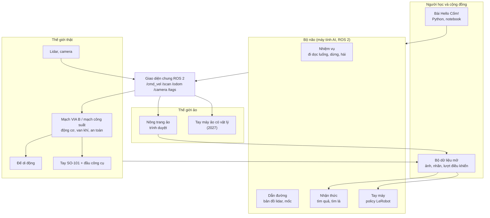

# Kiến trúc tổng thể VIA Cốm

Bản 0.1 · 22/11/2026 · Đề xuất, chờ nhóm kỹ thuật Maker Việt rà soát.

VIA Cốm được thiết kế quanh một nguyên tắc: **một giao diện, hai thế giới**. Phần mềm điều khiển nói chuyện với robot qua cùng một bộ tên gọi ROS 2, dù phía sau là nông trang ảo hay robot thật ngoài vườn. Nhờ vậy người không có robot vẫn đóng góp được, và mọi thứ được thử trên máy tính trước khi ra vườn.

## Sơ đồ tổng thể

## Năm tầng

### 1. Phần cứng

Theo bản 1 đã chốt trong tài liệu định hướng:

| Khối | Bản 1 (2026–2027) | Về sau |
| --- | --- | --- |
| Đế di động | 2 bánh chủ động + bánh tự lựa, nền cứng | 4 bánh, rồi xích nếu số đo ngoài vườn đòi hỏi |
| Cánh tay | Khung SO-101 trên cột nâng | Cánh tay mềm lụa–silicone |
| Đầu công cụ | Tay mềm 3 xúc tu có lưỡi cắt cuống; đầu tuốt lá dâu | Gieo hạt, diệt cỏ |
| Cảm biến | Lidar 2D, camera đo chiều sâu, mốc AprilTag | GPS RTK |
| Mạch điều khiển | Mạch VIA B lái động cơ | Mạch công suất VIA Cốm (thêm cổng servo nối chuỗi, kênh van khí) |
| Máy tính AI | Bo RK3588 có sẵn | NEO AI |

Mọi đầu công cụ cắm vào một "Cổng công cụ VIA" chung (cơ khí, điện, khí, nhận dạng), để cộng đồng tự làm đầu mới.

### 2. Firmware

Mạch ESP32 lo việc thời gian thực: điều tốc hai bánh, đọc encoder và cảm biến nghiêng, đóng mở van, dừng khẩn cấp. Nó nhận lệnh tốc độ trái–phải từ máy tính AI. Cả ba kiểu đế (2 bánh, 4 bánh, xích) đều lái bằng hai động cơ trái–phải, nên đổi đế không phải viết lại phần mềm tầng trên.

### 3. Bộ não ROS 2

Kế thừa cách chia khối của via-ros-2 (driver, nhận thức, điều khiển tách rời), chuyển lên bản ROS 2 hỗ trợ dài hạn hiện hành thay cho Foxy đã hết hỗ trợ.

| Gói (dự kiến) | Việc | Nguồn |
| --- | --- | --- |
| `via_com_base` | Nối máy tính AI với mạch điều khiển, phát `/odom`, nhận `/cmd_vel` | Viết mới |
| `via_com_sim_bridge` | Cùng giao diện, nhưng phía sau là nông trang ảo | Đã có bản 0.1 |
| `via_com_navigation` | Lập bản đồ lidar, định vị, đi theo tuyến, sửa sai bằng mốc | Dùng gói mở sẵn có (slam_toolbox, Nav2) |
| `via_com_perception` | Tìm quả, tìm lá, đánh giá độ chín | Mô hình huấn luyện từ bộ dữ liệu VIA Cốm |
| `via_com_manipulation` | Chạy policy hái quả, tuốt lá | LeRobot |
| `via_com_mission` | Kịch bản: đi dọc luống → dừng ở cây → hái → đặt vào khay | Viết mới |

"Bám làn đường" của VIA B trở thành "bám luống" của VIA Cốm. Bài Hello Cốm! hiện làm việc này bằng lidar.

### 4. Mô phỏng

Ba bậc, từ nhẹ đến đầy đủ: nông trang ảo trên trình duyệt (đã có), cầu nối ROS 2 (đã viết), tay máy ảo có vật lý (2027). Xem [SIMULATION.md](SIMULATION.md).

### 5. Dữ liệu và học

Mỗi lần robot chạy, ảo hay thật, đều sinh dữ liệu theo cùng một quy cách. Dữ liệu ảo có nhãn tự động, dùng để tập và để khởi động mô hình. Dữ liệu thật từ vườn Việt Nam là tài sản chính. Xem [DATASET.md](DATASET.md).

## Vòng làm việc của robot

1. Đi dọc luống theo bản đồ lidar đã lưu, sửa sai số bằng mốc ở đầu luống.
2. Dừng hẳn ở từng cây. Bản 2 bánh dễ chúi khi tay vươn xa, nên không vừa đi vừa hái.
3. Camera cổ tay tìm quả hoặc cành lá.
4. Policy đưa tay tới, đầu công cụ ôm quả và cắt cuống, hoặc tuốt lá.
5. Đặt sản phẩm vào khay trên đế, ghi lại dữ liệu, đi tiếp.

## Nguyên tắc thiết kế

- **Nhẹ trước, đủ sau.** Mọi thành phần có một bản chạy được trên máy tính phổ thông.
- **Thử ảo trước khi thử thật.** Tính năng mới phải chạy trong mô phỏng trước khi lên robot.
- **Dữ liệu là sản phẩm.** Mỗi lần chạy đều ghi dữ liệu theo quy cách chung.
- **Thay được từng khối.** Đổi đế, đổi tay, đổi máy tính AI không kéo theo viết lại các khối khác.
- **Mở và rẻ.** Linh kiện phổ thông, giấy phép mở, tài liệu tiếng Việt.

## Điểm còn mở

- Cách nối máy tính AI với mạch điều khiển: micro-ROS hay giao thức nối tiếp riêng.
- Bản ROS 2 cụ thể và hệ điều hành trên bo RK3588.
- Phần mềm 3D cho bậc 3: MuJoCo là đề xuất, chưa so sánh thực nghiệm với Gazebo hay Isaac Sim.
- Dòng động cơ so với sức chịu của mạch VIA B (cần đo trước khi chốt bản 1).
