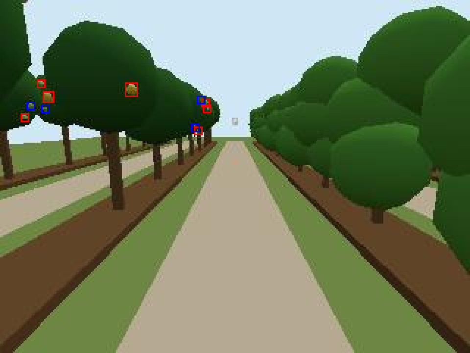

# Bộ dữ liệu robot AI nông nghiệp Việt Nam

Quy cách bản 0.1 · 22/11/2026 · Đề xuất, sẽ đổi khi có dữ liệu thật đầu tiên.

Mục tiêu: một bộ dữ liệu mở, thu ở vườn Việt Nam, đủ để huấn luyện robot nhìn cây và hái quả. Hiện chưa có bộ dữ liệu nào như vậy cho dâu tằm và chanh trồng ở Việt Nam mà chúng tôi biết.

## Ba loại dữ liệu

| Loại | Là gì | Dùng để | Ai góp được |
| --- | --- | --- | --- |
| A. Ảnh cây có nhãn | Ảnh lá, quả, cành kèm khung bao và độ chín | Dạy robot nhìn | Ai có điện thoại và một cái cây |
| B. Phiên di chuyển | Ảnh camera, lidar, vị trí, lệnh lái theo thời gian | Dạy robot đi dọc luống | Ai chạy nông trang ảo hoặc có đế robot |
| C. Lượt điều khiển tay máy | Hình ảnh và chuyển động khớp khi người điều khiển tay hái quả | Dạy robot hái | Nơi có tay SO-101 (và tay máy ảo từ 2027) |

Mỗi loại chia hai nguồn: `sim` (từ mô phỏng, nhãn tự động) và `real` (từ vườn thật). Hai nguồn luôn để riêng và ghi rõ, không trộn khi đánh giá.

## Quy cách loại B (đã dùng được)

Mỗi phiên là một thư mục:

```
ten_phien/
  meta.json        thông tin phiên
  frames.jsonl     mỗi dòng một thời điểm
  images/000002.jpg ...
```

`meta.json`: phiên bản quy cách, nguồn (`sim` hoặc `real`), bản đồ hoặc tên vườn, loại cây, người góp, giấy phép, ngày giờ, thông số camera.

Mỗi dòng của `frames.jsonl`:

| Trường | Ý nghĩa |
| --- | --- |
| `time` | Giây kể từ đầu phiên |
| `image` | Đường dẫn ảnh |
| `pose` | `x`, `y` (mét), `theta` (radian) |
| `action` | Lệnh đang thực hiện: `linear` (m/s), `angular` (rad/s) |
| `lidar` | Giống gói dữ liệu của nông trang ảo |
| `tags` | Mốc đang thấy |
| `labels` | Danh sách `class`, `bbox` [x, y, rộng, cao] tính bằng điểm ảnh, `distance` |

Công cụ `tools/record_dataset.py` ghi đúng quy cách này từ nông trang ảo.



Khung đỏ là chanh chín, khung xanh là chanh chưa chín. Nhãn do giả lập tự sinh, đã bỏ các quả bị tán lá che.

## Quy cách loại A và C (dự kiến)

- **Loại A:** ảnh JPEG kèm tệp nhãn cùng cấu trúc `labels` ở trên. Các lớp ban đầu: `lemon_ripe`, `lemon_unripe`, `mulberry_leaf`, `mulberry_shoot` (ngọn non, không được hái). Mỗi ảnh ghi nơi chụp, ngày, điều kiện ánh sáng.
- **Loại C:** theo định dạng LeRobot, để dùng thẳng công cụ huấn luyện sẵn có và chia sẻ được với cộng đồng quốc tế.

## Nguyên tắc

- **Giấy phép:** CC BY 4.0. Người góp được ghi tên.
- **Riêng tư:** không có mặt người, biển số, nhà riêng trong ảnh. Người góp xác nhận có quyền chụp ở vườn đó.
- **Chất lượng hơn số lượng:** mỗi đợt có một phần được người thứ hai kiểm nhãn.
- **Chia tập cố định:** tập huấn luyện, kiểm tra và đánh giá chia theo vườn, không chia ngẫu nhiên theo ảnh, để đo đúng khả năng làm việc ở vườn mới.
- **Ghi cả thất bại:** lượt hái hỏng cũng có giá trị, được đánh dấu chứ không xoá.

## Lưu trữ

Dữ liệu lớn không nằm trong git. Đề xuất: bản phát hành trên GitHub cho các đợt nhỏ như VIA Datasets đã làm, và một kho dữ liệu mở (ví dụ Hugging Face Hub) khi dung lượng lớn. Chờ Maker Việt chốt.

## Mục tiêu theo năm

Xem bảng trong [Kế hoạch 2026–2030](ROADMAP-2026-2030.md#mục-tiêu-bộ-dữ-liệu-đề-xuất).
