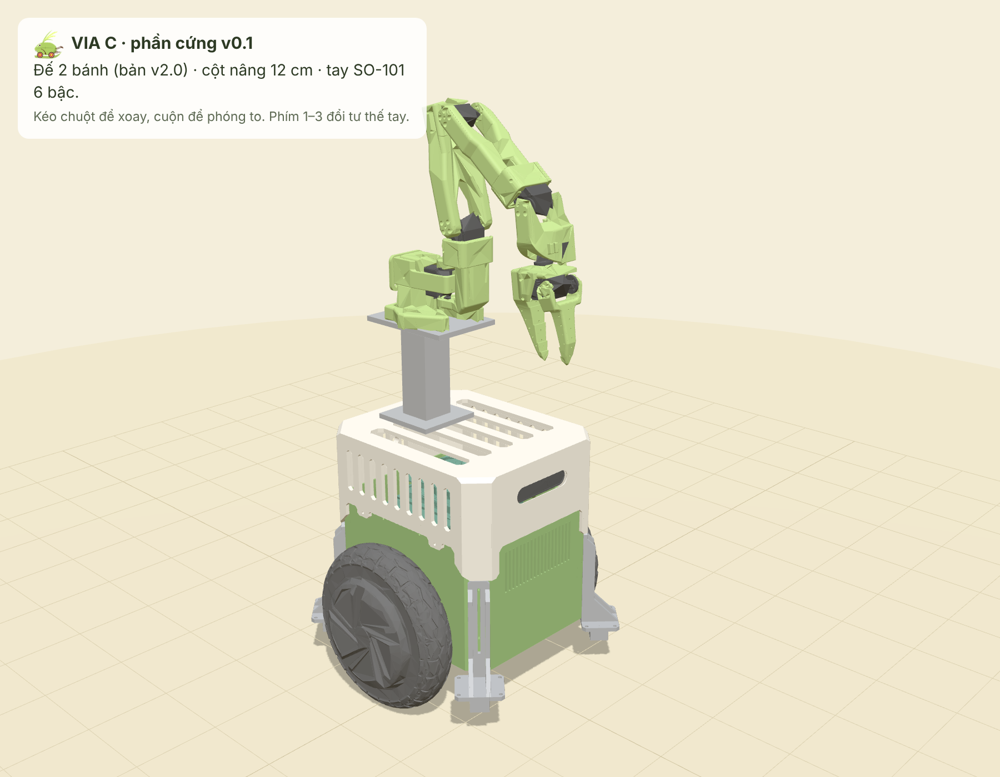
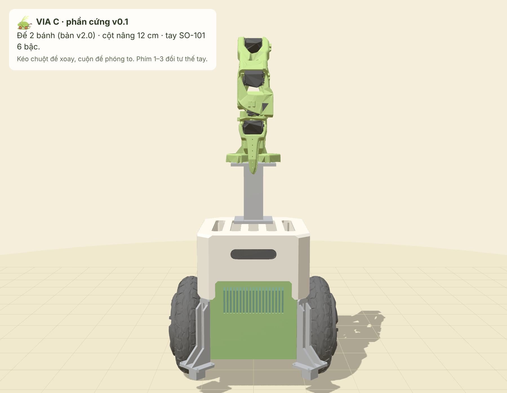
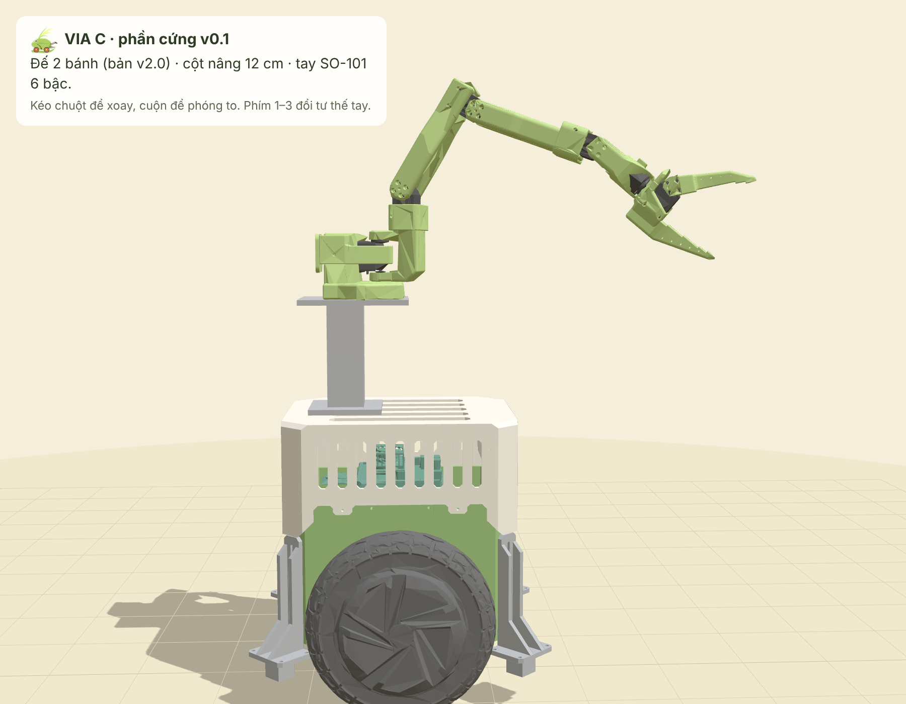
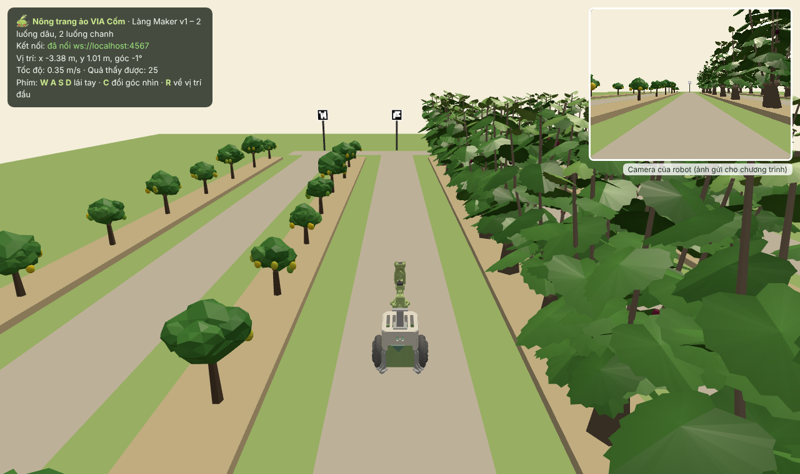
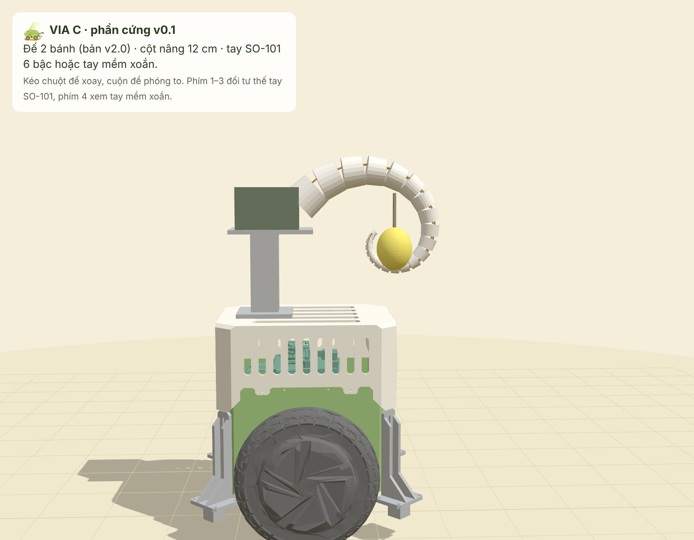
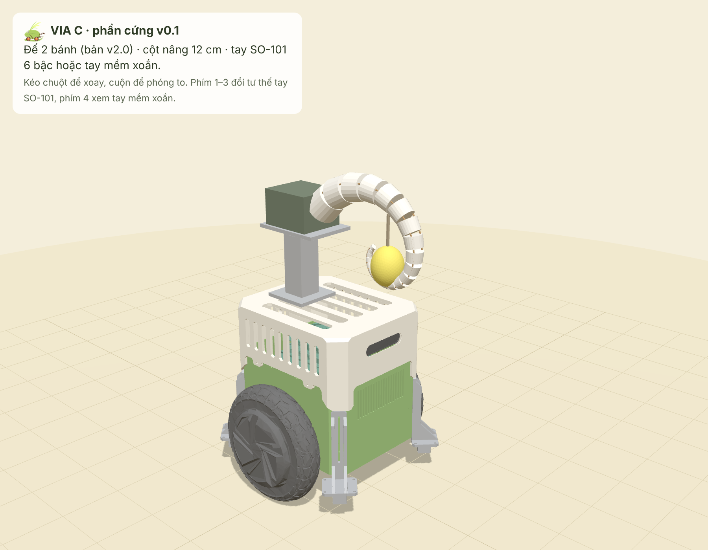

# VIA C phần cứng v0.1

Bản ghép thử 22/11/2026: đế 2 bánh **v2.0** (thiết kế Onshape của nhóm) + **cột nâng 12 cm** + tay **SO-101** của LeRobot. Đây là mô hình 3D để bàn thiết kế và chạy trong nông trang ảo, chưa phải bản vẽ chế tạo.

| Mặt trước | Tay vươn hái |
| --- | --- |
|  |  |

Xem và xoay mô hình 3D: chạy `python tools/run_sim.py` rồi mở `http://localhost:8000/web/robot.html` (phím 1, 2, 3 đổi tư thế tay SO-101, phím 4 xem tay mềm xoắn).

## Thông số đo từ file 3D

| Phần | Số đo |
| --- | --- |
| Đế (cả bánh) | 32 × 33 cm, cao 30 cm tới mặt nắp |
| Bánh chủ động | 2 bánh giữa thân, đường kính khoảng 19,6 cm, tâm hai bánh cách nhau khoảng 22 cm |
| Chân đỡ | 4 chân góc, mỗi chân có đệm trượt nhỏ chạm đất |
| Camera trước | Sau khe ở mặt trước vỏ, cao khoảng 27 cm so với mặt đất |
| Mặt nắp | Phẳng, cao 30 cm so với đất, đủ chỗ bắt cột nâng |
| Cột nâng | Nhôm định hình 40 × 40, cao 12 cm, đặt lùi về sau 6 cm so với tâm |
| Vai tay SO-101 | Cao khoảng 49 cm so với đất |
| Cả robot, tay ở tư thế sẵn sàng | Cao khoảng 68 cm |
| Tầm với tay SO-101 | Khoảng 40 cm tính từ vai |

Với vai ở 49 cm và tầm với 40 cm, tay hái được quả chanh trên cây 0,4–0,7 m. Ngọn cây dâu 1,2–1,5 m nằm ngoài tầm, cần cột nâng có ray trượt như trong phác thảo.

## Trong nông trang ảo

Nông trang ảo đã thay hộp cam cũ bằng mô hình này và dùng số đo thật của đế: khoảng cách hai bánh 22 cm, bán kính va chạm 24 cm. Camera gửi cho chương trình giờ là camera trước của đế ở độ cao 27 cm. Muốn so với camera trên cột 0,75 m như bản 1 trong tài liệu định hướng, mở trang với `?cam=cot`.

Đã thử ngày 22/11/2026: chương trình mẫu Hello Cốm vẫn tự đi giữa luống, lệch tâm khoảng 2 cm, và thấy nhiều quả chanh hơn vì camera thấp ngang tán chanh.

## Phương án tay mềm xoắn

| Góc nghiêng |
| --- |
|  |

Đây là phương án thay SO-101 bằng tay mềm theo nguyên lý xoắn ốc logarit, ý tưởng từ dự án [Open Spiral Robots](https://github.com/ZhanchiWang/Open-Spiral-Robots) (SpiRobs). Tay gồm 22 đốt, mỗi đốt nhỏ hơn đốt trước theo cùng một tỉ lệ, từ 5,5 cm ở gốc xuống 0,8 cm ở ngọn, dài khoảng 42 cm. Ba sợi cáp chạy dọc mép đốt và cuộn về một hộp 3 động cơ trên đỉnh cột. Kéo cáp thì mọi khớp gập cùng một góc, nên tay tự cuộn thành vòng xoắn và ôm quả mà không cần biết trước kích thước quả.

Vì sao hợp với VIA Cốm:

- Mềm, chạm cây và người không gây hại; hợp với bước 2 trong [CONG-CONG-CU.md](CONG-CONG-CU.md) (cánh tay mềm lụa–silicone).
- Chỉ cần 3 động cơ thay vì 6 servo, rẻ hơn và dễ chống nước hơn.
- Một tay ôm được quả nhiều cỡ: chanh, ổi, cả chùm lá dâu.

Giới hạn: tay mềm không định vị chính xác như SO-101, và cần lưỡi cắt cuống hoặc động tác xoay để tách quả. Mô hình trên là hình học tự dựng theo nguyên lý, chưa phải thiết kế để in.

**Lưu ý giấy phép:** repo Open Spiral Robots dùng giấy phép PolyForm Noncommercial, cấm dùng cho mục đích thương mại nếu không có giấy phép riêng. VIA C không chép bản vẽ hay mã của repo đó vào đây. Nếu muốn dùng công cụ thiết kế hay file in của họ cho sản phẩm bán ra, cần liên hệ tác giả xin giấy phép thương mại.

## Khác với bản phác thảo

| Phác thảo trong tài liệu định hướng | Đế v2.0 hiện tại |
| --- | --- |
| Thân khoảng 45 × 60 cm, chở pin, bơm, khay nông sản | Thân 32 × 33 cm, gọn hơn, chưa có chỗ cho bơm khí và khay |
| Cột cảm biến riêng có lidar và camera đo chiều sâu | Camera trước trong vỏ; chưa thấy lidar trên mô hình |
| Cột nâng có ray trượt 40–60 cm | Cột cố định 12 cm (giả định của bản ghép này) |

Đế nhỏ hợp với bản v0 chạy trong nhà và lớp học. Khi ra vườn thật sẽ cần đế lớn hơn hoặc đế P2 theo [ARCHITECTURE.md](ARCHITECTURE.md).

## Tệp trong repo

| Tệp | Dùng để |
| --- | --- |
| `hardware/v0.1/via_c_v0_1.urdf` | Mô tả robot cho ROS 2, RViz, Gazebo, Isaac Sim: đế, camera trước, cột nâng, 6 khớp tay SO-101 |
| `hardware/v0.1/meshes/` | Lưới 3D đã giảm chi tiết của đế v2.0 và các khâu SO-101 |
| `hardware/v0.1/tao_mo_hinh.py` | Chương trình ghép lại mô hình khi đế hoặc vị trí cột thay đổi |
| `sim/web/models/*.glb` | Mô hình có màu: 3 tư thế SO-101 (sẵn sàng, vươn hái, gập) và tay mềm xoắn |
| `sim/web/robot.html` | Trang xem mô hình 3D |

Tay SO-101 lấy từ repo [TheRobotStudio/SO-ARM100](https://github.com/TheRobotStudio/SO-ARM100), giấy phép Apache-2.0, bản sao giấy phép nằm ở `hardware/v0.1/meshes/so101/`.

## Việc cần chốt

- Vị trí và chiều cao cột nâng: cố định 12 cm như bản này, hay ray trượt để với tới cây dâu.
- Camera chính: camera trước của đế (27 cm), thêm cột camera 0,75 m, hay thêm camera cổ tay của SO-101.
- Có gắn lidar 2D cho bản v0 không, và gắn ở đâu để tay không che.
- Đế v2.0 cần tách bánh thành khối riêng trong Onshape để mô phỏng bánh quay; bản xuất STL hiện gộp thành một khối.
- Chọn tay cho bản v0: SO-101 (chính xác, có sẵn dữ liệu LeRobot) hay tay mềm xoắn (an toàn, rẻ, cần xin giấy phép nếu dùng bản vẽ gốc).
- Kiểm cân bằng: tay vươn hết tầm về trước khi đế chỉ có 2 bánh giữa và 4 chân đỡ.
