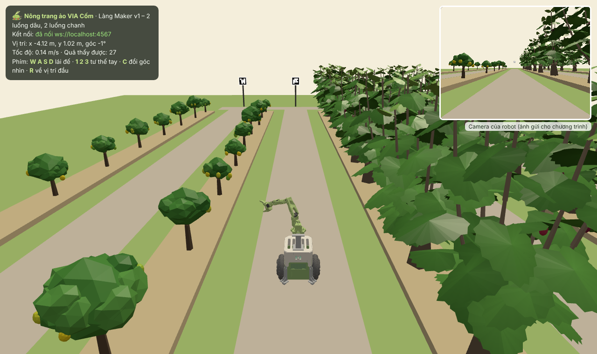
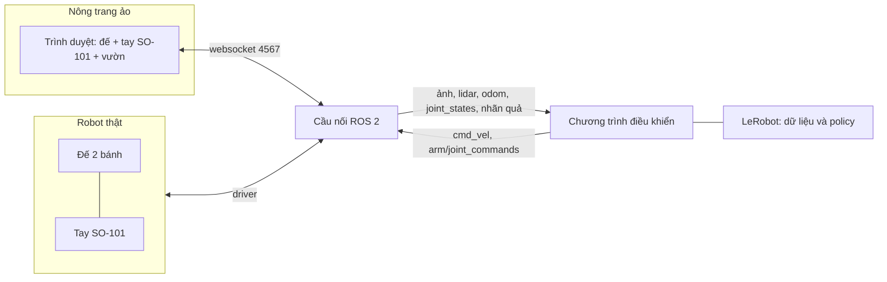

# Khung giải pháp VIA C bản v0

Bản 0.1 · 22/11/2026 · Tập trung vào ba khối: **đế 2 bánh**, **tay SO-101 (LeRobot)** và **nông trang ảo**. Tay mềm tạm gác ([TAY-MEM-XOAN.md](TAY-MEM-XOAN.md)).

## Bài toán bản v0

Robot tự đi giữa luống chanh, nhìn thấy quả chín, đưa tay tới và hái. Làm trước trong nông trang ảo, rồi chạy cùng phần mềm trên robot thật ở Làng Maker.

## Ba khối

| Khối | Bản v0 | Trạng thái |
| --- | --- | --- |
| Đế di động | Đế 2 bánh v2.0 (32 × 33 cm), camera trước 27 cm | Có mô hình 3D và số đo ([HARDWARE-v0.1.md](HARDWARE-v0.1.md)); chưa chế tạo |
| Tay | SO-101 6 bậc trên cột nhôm 12 cm, servo STS3215 bản 12 V | Có URDF, có khớp trong mô phỏng; mua bộ kit sẵn |
| Mô phỏng | Nông trang ảo trên trình duyệt: luống chanh, luống dâu, nhãn quả chín tự động | Đế tự đi luống được; tay nhận lệnh 6 khớp; chưa có vật lý nắm quả |

## Một giao diện chung cho ảo và thật

Chương trình điều khiển chỉ nói chuyện qua một bộ tên chung: `/cmd_vel` cho đế, 6 khớp mang tên của LeRobot cho tay, `/joint_states` để đọc lại góc tay. Nhờ vậy, chương trình tập trên nông trang ảo chạy được trên robot thật mà không phải sửa.

## Chia việc giữa đế và tay

| Việc | Ai làm | Cách làm ở v0 |
| --- | --- | --- |
| Đi giữa luống, dừng ở cuối luống | Đế | Lidar thấy hai hàng cây và mốc cuối luống (đã chạy trong mô phỏng) |
| Tìm quả chín | Camera trước + AI | Nhận dạng quả chín bằng màu, học từ nhãn tự động của nông trang ảo rồi tinh chỉnh bằng ảnh thật |
| Dừng đúng chỗ | Đế | Đi chậm khi thấy quả chín gần, dừng khi quả nằm trong tầm tay (khoảng 25 cm quanh vai) |
| Đưa tay tới và hái | Tay SO-101 | Policy LeRobot học từ người điều khiển bằng tay leader SO-101 |
| Bỏ quả vào khay | Tay | Tư thế cố định |

## Đường đi của dữ liệu và policy

1. **Mô phỏng:** tập đi luống, tìm quả, dừng đúng chỗ. Ví dụ đã có: `drive.py` (đi luống) và `arm_point.py` (thấy quả chín thì xoay tay chỉ về quả).
2. **Ghi dữ liệu thật:** người điều khiển tay leader SO-101, robot ghi ảnh và góc khớp theo chuẩn bộ dữ liệu LeRobot ([DATASET.md](DATASET.md)).
3. **Huấn luyện:** dùng các policy có sẵn trong LeRobot (ví dụ ACT hoặc SmolVLA) cho động tác hái.
4. **Chạy trên robot:** policy gửi lệnh khớp qua cùng giao diện ở trên.

## Đã có và còn thiếu

| Đã có (22/11/2026) | Còn thiếu cho v0 |
| --- | --- |
| Mô hình 3D và URDF đế + SO-101 | Chế tạo đế, chọn pin và mạch lái động cơ |
| Nông trang ảo: đế tự đi luống, tay nhận lệnh 6 khớp, nhãn quả chín | Vật lý cho tay nắm quả; camera cổ tay trong mô phỏng |
| Cầu nối ROS 2 có `/joint_states` và `/arm/joint_commands` (chưa chạy thử trên máy có ROS 2) | Driver ROS 2 cho đế và tay thật |
| Ví dụ `arm_point.py` | Bộ dữ liệu hái chanh thật đầu tiên và policy đầu tiên |

## Việc cần chốt

- Camera chính: camera trước 27 cm, cột camera 0,75 m, hay thêm camera cổ tay SO-101.
- Cột tay cố định 12 cm hay ray trượt.
- Có gắn lidar 2D cho v0 không, gắn ở đâu.
- Máy tính trên robot cho v0 (bo RK3588 có sẵn hay NEO AI) để chạy policy LeRobot.
