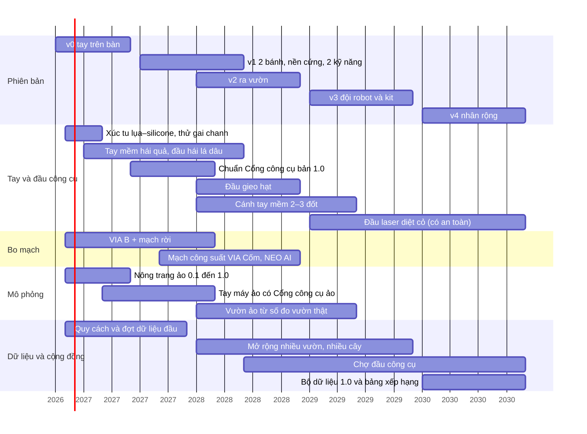

# Kế hoạch 5 năm 2026–2030

Bản 0.2 · 22/11/2026 · Đề xuất, khớp với tài liệu định hướng VIA Cốm 2026–2030. Mốc thời gian và các con số mục tiêu chưa gắn với ngân sách hay nhân sự, cần Maker Việt chốt.

Đích đến năm 2030: robot VIA Cốm làm việc thật theo mùa vụ ở vườn và hợp tác xã, và Việt Nam có một **bộ dữ liệu mở về robot AI nông nghiệp** do cộng đồng cùng xây.

Bốn dòng việc chạy song song:

- **Robot thật:** đi từ tay trên bàn thí nghiệm ra vườn, mỗi phiên bản một bước về địa hình và kỹ năng.
- **Tay và đầu công cụ:** từ khung cứng SO-101 tới cánh tay mềm lụa–silicone; các đầu công cụ thay nhanh qua Cổng công cụ VIA.
- **Mô phỏng:** để người không có robot vẫn lập trình được, và mọi thứ được thử ảo trước.
- **Dữ liệu và cộng đồng:** bộ dữ liệu mở, bộ kit, giáo trình, chợ đầu công cụ.

Mỗi phiên bản chỉ bắt đầu khi bản trước đã **qua cửa**.

## Năm phiên bản

| Phiên bản | Thời gian | Mô hình robot | Việc chính | Cửa để sang bản sau |
| --- | --- | --- | --- | --- |
| **v0** · Tay trên bàn | Q4/2026 – Q2/2027 | SO-101 để bàn, đầu tay bạch tuộc lụa–silicone | Đổ xúc tu, nối LeRobot, thu 50–200 lượt điều khiển tay; làm mẫu đầu hái lá dâu cầm tay | Hái và đặt quả mềm ổn định trên bàn, không dập |
| **v1** · 2 bánh, nền cứng | Q3/2027 – Q2/2028 | Đế P1 2 bánh + lidar; SO-101 trên cột nâng; tay mềm hái quả và đầu hái lá dâu | Bản đồ lidar, đi theo tuyến; hái lá dâu và hái chanh tại điểm dừng | Tiêu chí đã duyệt 21/11/2026 (bên dưới) |
| **v2** · Ra vườn | 2028 | Đế P2 4 bánh (P3 xích nếu số đo đòi hỏi); mạch công suất VIA Cốm; cánh tay mềm 2–3 đốt | Lối vườn thật, da cảm biến tơ tằm, bộ dữ liệu mở | Robot thứ hai lắp lại được chỉ từ tài liệu nguồn mở |
| **v3** · Đội robot và kit | 2029 | 3–5 robot; kit VIA Cốm | Kit cho trường và CLB STEM; ra lệnh bằng tiếng Việt; thí điểm ở hợp tác xã | Một trường hoặc hợp tác xã tự vận hành robot, không cần đội Maker Việt |
| **v4** · Nhân rộng | 2030 | Bản cho hợp tác xã và nhà kính | Nhân rộng; chuẩn bị thế hệ VIA tiếp theo | Có nơi ngoài Làng Maker tự dựng và vận hành robot từ tài liệu mở |

**Cửa của v1 (đã duyệt 21/11/2026):** tự đi hết tuyến trên bản đồ 10 lần liên tiếp, không lạc, không va; hái được ít nhất 7 trong 10 quả chanh nhìn thấy mà không dập quả, không thủng xúc tu; tuốt hết lá một cành dâu trong dưới 1 phút, không gãy ngọn.

Xem mô hình robot và tải từng tầng ở [ARCHITECTURE.md](ARCHITECTURE.md#mô-hình-robot-bản-phác-thảo), chuẩn Cổng công cụ ở [CONG-CONG-CU.md](CONG-CONG-CU.md).

## Tổng quan

## Từng năm

### 2026 (cuối năm): v0 bắt đầu

- Mở repo, công bố kiến trúc, kế hoạch, quy cách dữ liệu và bản nháp chuẩn Cổng công cụ.
- Nông trang ảo bản 0.1 và bài Hello Cốm! (đã có).
- Đổ thử xúc tu lụa–silicone, thử với gai chanh thật.
- Làm mẫu đầu hái lá dâu trên cành thật, cầm tay trước khi gắn lên robot.

### 2027: hết v0, vào v1

- SO-101 để bàn với đầu tay bạch tuộc, nối LeRobot, thu lượt điều khiển tay.
- Dựng đế P1 2 bánh + lidar, lập bản đồ khu thử nền cứng.
- Gắn SO-101 lên cột nâng, thu 100–200 lượt điều khiển tay cho mỗi kỹ năng.
- Đầu quan sát và tuần tra luống, chụp ảnh từng cây để tạo dữ liệu cho mọi việc sau.
- Chốt chuẩn cơ khí, điện, khí và giao thức nhận dạng của Cổng công cụ.
- Tay máy ảo có vật lý, có cùng Cổng công cụ như bản thật.
- Công bố đợt dữ liệu đầu tiên.

### 2028: hết v1, v2 ra vườn

- Qua cửa v1 trên nền cứng.
- Đổi sang đế P2 4 bánh trên cùng thân; đo lực kéo, độ trượt, thời gian pin ngoài vườn.
- Mạch công suất VIA Cốm (4 kênh động cơ lớn, cổng servo Feetech, 8 kênh van, cổng CAN tới đầu công cụ) và NEO AI.
- Cánh tay mềm VIA 2–3 đốt lụa–silicone; da cảm biến tơ tằm trên xúc tu.
- Đầu gieo hạt; nhặt và xếp nông sản vào khay.
- Dựng vườn ảo từ số đo của vườn thật; thu dữ liệu ở vườn thứ hai, thứ ba.
- Mở chợ đầu công cụ: công bố bản vẽ mẫu để cộng đồng tự làm đầu mới.

### 2029: v3 đội robot và kit

- Đội 3–5 robot chạy theo mùa vụ dâu và chanh, đo năng suất so với hái tay.
- Làm đế P3 xích chỉ khi số đo 2028 cho thấy bánh lún hoặc không vượt được rãnh.
- Phân loại độ chín bằng AI (camera cổ tay và cảm biến tơ tằm cảm nhận độ mềm).
- Ra lệnh cho robot bằng tiếng Việt.
- Kit VIA Cốm cho trường và CLB STEM; thí điểm ở một hợp tác xã.
- Đầu laser diệt cỏ chỉ bắt đầu khi đã có váy che kín, khoá liên động phần cứng và quy trình an toàn.

### 2030: v4 nhân rộng

- Bản cho hợp tác xã và nhà kính; dịch vụ triển khai.
- Bộ dữ liệu bản 1.0, có bảng xếp hạng mô hình để các nhóm nghiên cứu so sánh.
- Chuẩn bị thế hệ VIA tiếp theo.

## Hệ sinh thái mở

Bốn tầng mở, ai cũng thêm được đầu công cụ, dữ liệu hoặc bài học. Vai trò từng bên là đề xuất, cần Maker Việt và ThingEdu thống nhất.

| Tầng | Gồm gì | Dẫn dắt (đề xuất) |
| --- | --- | --- |
| Cộng đồng và ứng dụng | Làng Maker làm bãi thử; trường và CLB STEM; hợp tác xã; cuộc thi thiết kế đầu công cụ | Maker Việt cùng ThingEdu |
| Dữ liệu và AI | Bộ dữ liệu nông nghiệp mở; policy LeRobot cho từng đầu công cụ; AI tiếng Việt | ThingEdu |
| Phần mềm | via-ros-2, plugin LeRobot, firmware mạch công suất, nông trang ảo | Maker Việt |
| Phần cứng mở, xoay quanh Cổng công cụ VIA | Đế, cánh tay lụa–silicone, các đầu công cụ, NEO AI và mạch công suất | Maker Việt: cơ khí, mạch công suất · ThingEdu: NEO AI, bộ kit |

- **Thang học tập:** THCS lập trình điều khiển trên mạch công suất; THPT làm đầu công cụ và thu dữ liệu; sinh viên huấn luyện AI trên NEO AI.
- **Dữ liệu góp chung:** mỗi trường, mỗi vườn góp lượt điều khiển tay và ảnh cây trồng vào bộ dữ liệu mở.
- **Vòng tơ tằm:** Làng Maker trồng dâu, nuôi tằm, lấy tơ làm cảm biến; robot quay lại hái lá dâu.
- **Nguồn thu nuôi dự án:** bán bo mạch và bộ kit, khoá học và tập huấn giáo viên, dịch vụ triển khai cho hợp tác xã; thiết kế vẫn mở.

## Mục tiêu bộ dữ liệu (đề xuất)

| Năm | Lượt điều khiển tay máy | Ảnh thật có nhãn | Loại cây | Nơi góp |
| --- | --- | --- | --- | --- |
| 2027 | 200–400 | 10.000 | 2 (dâu, chanh) | 1 |
| 2028 | 2.000 | 50.000 | 4 | 3 |
| 2029 | 5.000 | 100.000 | 6 | 6 |
| 2030 | 10.000 | 200.000 | 10 | 10 |

Con số 2027 lấy từ ước lượng 100–200 lượt cho mỗi kỹ năng trong tài liệu định hướng. Các năm sau là mục tiêu đề xuất, chưa có cơ sở đo đạc; nên đặt lại sau khi đo tốc độ thu thật trong 2027. Để so sánh: VIA Datasets 1.0 của VIA B có 18.783 ảnh.

## Rủi ro chính

| Rủi ro | Cách giảm |
| --- | --- |
| Môi trường ngoài trời (bùn, mưa, nắng) vượt sức linh kiện giáo dục | Bắt đầu trên nền cứng, trong nhà kính hoặc luống có mái che |
| Tải SO-101 nhỏ (~500 g) | Chỉ hái quả nhẹ; quả nặng hơn dùng AR4 ở giai đoạn sau |
| Servo STS3215 không chống nước | Áo bọc tay, hoặc chỉ chạy khi trời khô |
| Gai chanh đâm thủng silicone | Lớp lụa gia cường trong xúc tu; thử với gai thật ngay từ v0 |
| Mạch VIA B thiếu cổng servo nối chuỗi và kênh van | Bản đầu dùng mạch rời; mạch VIA Cốm riêng từ v2 |
| Đầu laser gây mù, cháy | Chỉ làm sau khi có váy che, khoá liên động phần cứng và quy trình an toàn; gắn dưới gầm, chĩa xuống đất |
| Thiếu người duy trì, lặp lại việc VIA B dừng cập nhật từ 2023 | Có người phụ trách tài liệu và lịch phát hành cố định ngay từ đầu |
| AI hái quả cần nhiều dữ liệu | Biến thu dữ liệu thành hoạt động của học sinh và cộng đồng |
| Mô hình học trên ảnh ảo không chạy được ngoài đời | Dữ liệu ảo chỉ để tập và khởi động; luôn đánh giá trên dữ liệu thật |
| Chưa có ngân sách và nhân sự gắn với mốc | Chốt người và tiền cho năm 2027 trước, các năm sau cập nhật hằng năm |

## Quyết định cần chốt

- Loại cây trồng đầu tiên để thử hái tại Làng Maker.
- Kích thước luống và lối đi thật để chốt khung đế.
- Cấu hình và giá thành NEO AI: RK3588 hay RK3399.
- Chuẩn cơ khí và giao thức nhận dạng của Cổng công cụ VIA.
- Vai trò Maker Việt và ThingEdu trong từng tầng của hệ sinh thái.
