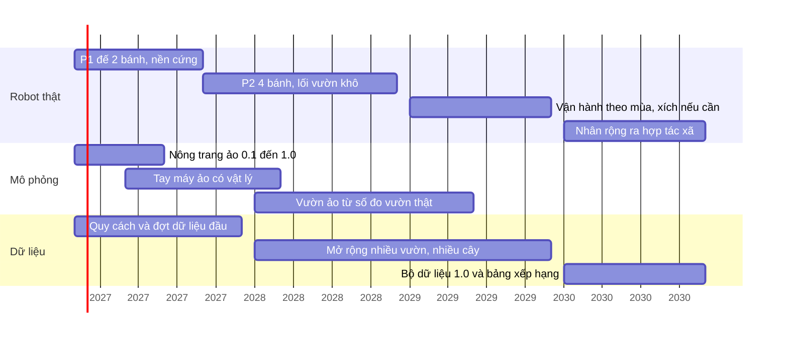

# Kế hoạch 5 năm 2026–2030

Bản 0.1 · 22/11/2026 · Đề xuất. Mốc thời gian và các con số mục tiêu chưa gắn với ngân sách hay nhân sự, cần Maker Việt chốt.

Đích đến năm 2030: robot VIA Cốm làm việc thật theo mùa vụ ở vườn và hợp tác xã, và Việt Nam có một **bộ dữ liệu mở về robot AI nông nghiệp** do cộng đồng cùng xây.

Hai dòng việc chạy song song suốt 5 năm:

- **Dòng thật:** robot ra vườn, mỗi năm một bước về địa hình và kỹ năng.
- **Dòng ảo và dữ liệu:** mô phỏng và bộ dữ liệu, để người không có robot vẫn tham gia và để AI có cái mà học.

Mỗi năm chỉ bắt đầu khi năm trước đã "qua cửa".

## Tổng quan

## Từng năm

### 2026 (cuối năm): Đặt nền móng

- Mở repo, công bố kiến trúc, kế hoạch và quy cách dữ liệu.
- Nông trang ảo bản 0.1 và bài Hello Cốm! (đã có).
- Đổ thử xúc tu lụa–silicone, thử với gai chanh thật.
- Làm mẫu đầu tuốt lá dâu cầm tay.

**Qua cửa:** một người mới làm theo hướng dẫn chạy được Hello Cốm! trong 15 phút.

### 2027: Bản 1, robot làm được việc trên nền cứng

- Dựng đế 2 bánh + lidar, lập bản đồ khu thử.
- Gắn SO-101 lên cột nâng, thu 100–200 lượt điều khiển từ xa cho mỗi kỹ năng.
- Chạy thử gói ROS 2, nối nông trang ảo với phần dẫn đường.
- Tay máy ảo có vật lý để tập hái trên máy tính.
- Công bố đợt dữ liệu đầu tiên.

**Qua cửa (tiêu chí đã duyệt 21/11/2026):** tự đi hết tuyến 10 lần liên tiếp không lạc, không va; hái được ít nhất 7 trong 10 quả chanh nhìn thấy mà không dập quả, không thủng xúc tu; tuốt hết lá một cành dâu trong dưới 1 phút, không gãy ngọn.

### 2028: Bản 2, ra lối vườn

- Chuyển sang 4 bánh trên cùng thân, đo lực kéo, độ trượt, thời gian pin ngoài vườn.
- Mạch công suất VIA Cốm thay cho mạch rời.
- Dựng vườn ảo từ số đo của vườn thật.
- Thu dữ liệu ở vườn thứ hai, thứ ba; thêm loại cây.
- Bộ kit và giáo trình cho trường học.

**Qua cửa:** chạy hết một luống thật trong ngày khô mà không lạc vị trí; có ít nhất 3 nơi ngoài Làng Maker góp dữ liệu.

### 2029: Vận hành theo mùa

- Robot chạy đều theo mùa vụ dâu và chanh, đo năng suất so với hái tay.
- Làm bản xích chỉ khi số đo 2028 cho thấy bánh lún hoặc không vượt được rãnh.
- Thí điểm ở một hợp tác xã.
- Thêm kỹ năng: phân loại độ chín, xếp nông sản vào khay.

**Qua cửa:** một mùa vụ trọn vẹn có số liệu năng suất, chi phí và hỏng hóc.

### 2030: Nhân rộng

- Một đội vài robot làm việc cùng lúc.
- Bộ dữ liệu bản 1.0, có bảng xếp hạng mô hình để các nhóm nghiên cứu so sánh.
- Bộ kit, tài liệu và dịch vụ triển khai đủ để nơi khác tự dựng.

**Qua cửa:** có nơi ngoài Làng Maker tự dựng và vận hành robot từ tài liệu mở.

## Mục tiêu bộ dữ liệu (đề xuất)

| Năm | Lượt điều khiển tay máy | Ảnh thật có nhãn | Loại cây | Nơi góp |
| --- | --- | --- | --- | --- |
| 2027 | 200–400 | 10.000 | 2 (dâu, chanh) | 1 |
| 2028 | 2.000 | 50.000 | 4 | 3 |
| 2029 | 5.000 | 100.000 | 6 | 6 |
| 2030 | 10.000 | 200.000 | 10 | 10 |

Con số 2027 lấy từ ước lượng 100–200 lượt cho mỗi kỹ năng trong tài liệu định hướng. Các năm sau là mục tiêu đề xuất, chưa có cơ sở đo đạc. Để so sánh: VIA Datasets 1.0 của VIA B có 18.783 ảnh.

## Rủi ro chính

| Rủi ro | Cách giảm |
| --- | --- |
| Môi trường ngoài trời vượt sức linh kiện giáo dục | Bắt đầu trên nền cứng và luống có mái che |
| Thiếu người duy trì, lặp lại việc VIA B dừng cập nhật từ 2023 | Có người phụ trách tài liệu và lịch phát hành cố định ngay từ đầu |
| AI hái quả cần nhiều dữ liệu | Biến thu dữ liệu thành hoạt động của học sinh và cộng đồng |
| Mô hình học trên ảnh ảo không chạy được ngoài đời | Dữ liệu ảo chỉ để tập và khởi động; luôn đánh giá trên dữ liệu thật |
| Chưa có ngân sách và nhân sự gắn với mốc | Chốt người và tiền cho năm 2027 trước, các năm sau cập nhật hằng năm |
