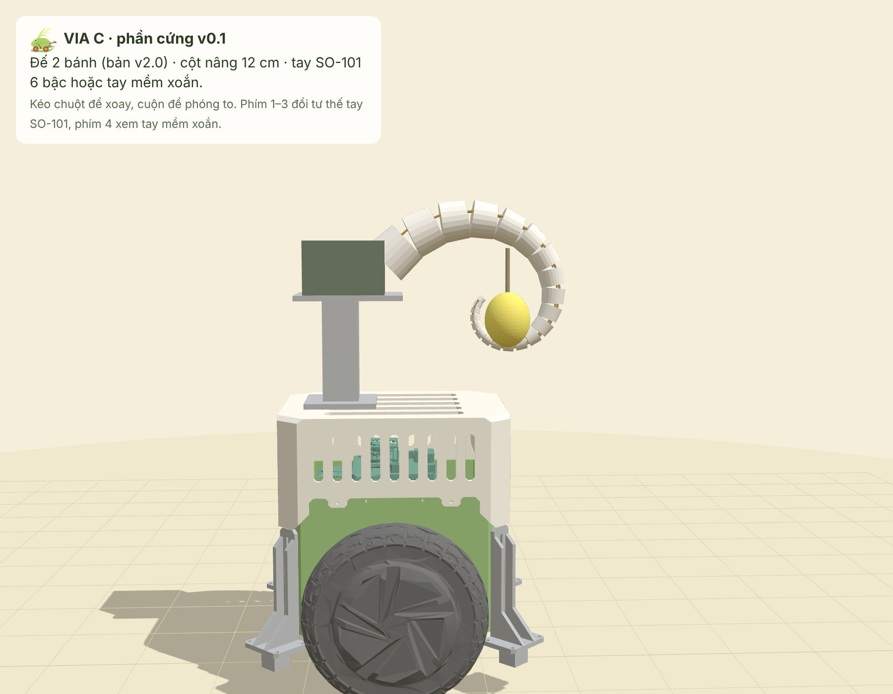
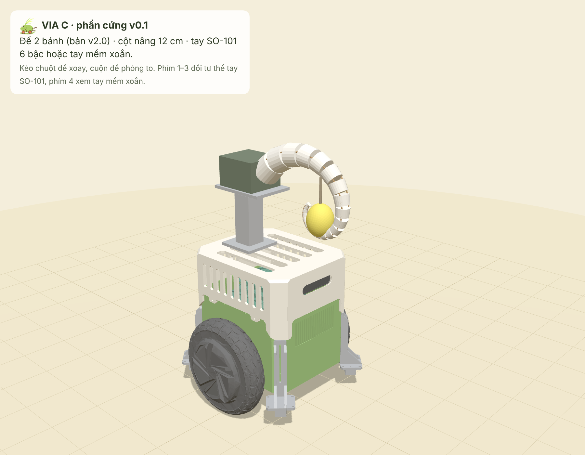
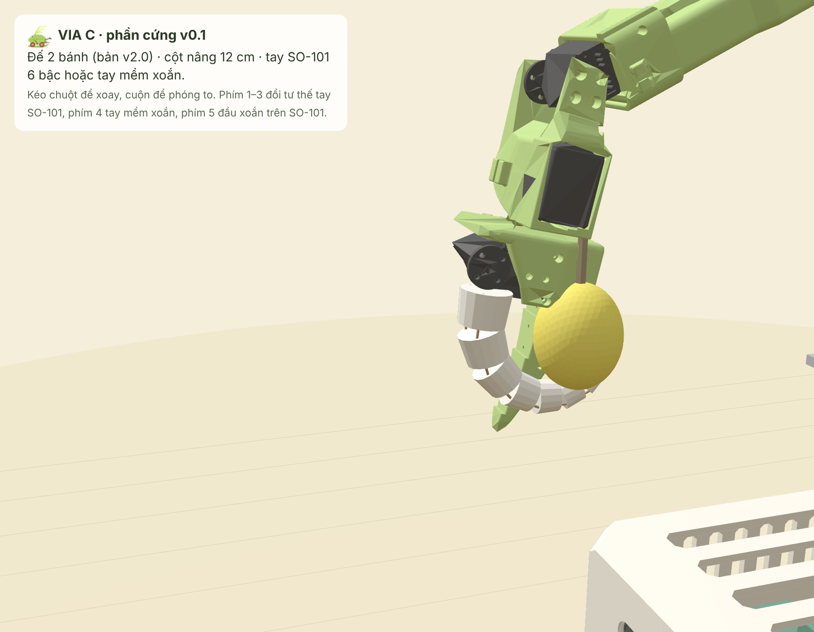
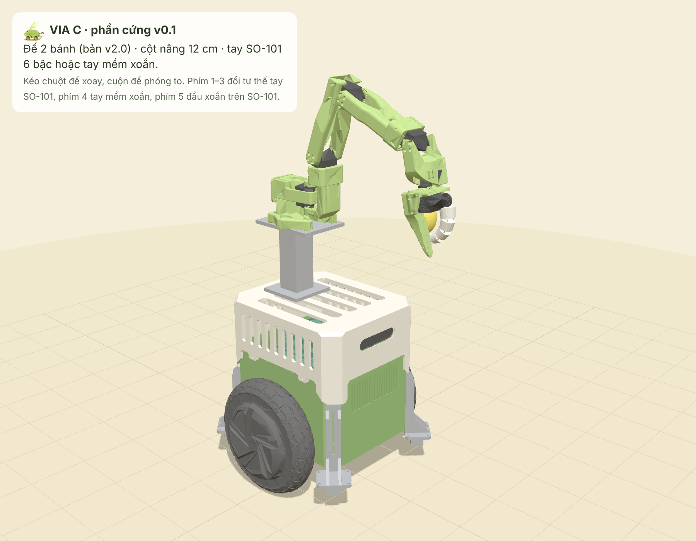

# Tay mềm xoắn ốc logarit (tạm gác)

**Trạng thái:** tạm gác từ 22/11/2026. Bản v0 tập trung vào tay SO-101, đế 2 bánh và mô phỏng ([HARDWARE-v0.1.md](HARDWARE-v0.1.md)). Ghi lại đây để quay lại ở bước cánh tay mềm.

Mô hình dựng lại bằng hàm `spiral_arm` và `spiral_chain` trong `hardware/v0.1/tao_mo_hinh.py`.

## Tay mềm xoắn thay SO-101

| Góc nghiêng |
| --- |
|  |

Đây là phương án thay SO-101 bằng tay mềm theo nguyên lý xoắn ốc logarit, ý tưởng từ dự án [Open Spiral Robots](https://github.com/ZhanchiWang/Open-Spiral-Robots) (SpiRobs). Tay gồm 22 đốt, mỗi đốt nhỏ hơn đốt trước theo cùng một tỉ lệ, từ 5,5 cm ở gốc xuống 0,8 cm ở ngọn, dài khoảng 42 cm. Ba sợi cáp chạy dọc mép đốt và cuộn về một hộp 3 động cơ trên đỉnh cột. Kéo cáp thì mọi khớp gập cùng một góc, nên tay tự cuộn thành vòng xoắn và ôm quả mà không cần biết trước kích thước quả.

Vì sao hợp với VIA Cốm:

- Mềm, chạm cây và người không gây hại; hợp với bước 2 trong [CONG-CONG-CU.md](CONG-CONG-CU.md) (cánh tay mềm lụa–silicone).
- Chỉ cần 3 động cơ thay vì 6 servo, rẻ hơn và dễ chống nước hơn.
- Một tay ôm được quả nhiều cỡ: chanh, ổi, cả chùm lá dâu.

Giới hạn: tay mềm không định vị chính xác như SO-101, và cần lưỡi cắt cuống hoặc động tác xoay để tách quả. Mô hình trên là hình học tự dựng theo nguyên lý, chưa phải thiết kế để in.

## Đầu xoắn nhỏ gắn trên cổ tay SO-101

| Cả robot |
| --- |
|  |

Cùng nguyên lý nhưng thu nhỏ để thay **ngàm động** của SO-101: 16 đốt, dài 16 cm, gốc 2,4 cm, ngọn 0,5 cm. Cáp cuốn vào trục servo kẹp sẵn có của SO-101, nên không thêm động cơ. Khi kéo cáp, đầu xoắn cuộn về phía **ngàm cố định** và ôm quả vào giữa: ngàm cứng giữ vị trí, phần xoắn mềm ôm theo cỡ quả.

Khối lượng (ước tính, chưa cân thật):

| Phần | Khối lượng |
| --- | --- |
| Đầu xoắn in TPU, đặc 60% (thể tích đặc 26 cm³) | khoảng 19 g |
| Cáp và ống cuốn cáp | khoảng 5 g |
| Bỏ ngàm động SO-101 | trừ 12 g |
| **Đầu công cụ tăng thêm** | **khoảng 12 g** |
| Quả chanh ta (hiểu biết chung) | 40–80 g |

Tải ở khớp vai (tính từ khối lượng các khâu trong mô hình SO-101):

| Tư thế | Mô-men vai, chưa có quả | Có thêm 100 g ở đầu |
| --- | --- | --- |
| Tư thế hái trong ảnh (đầu cách vai 22 cm) | 0,55 N·m | 0,77 N·m |
| Duỗi thẳng ngang, xa nhất (41 cm) | 0,86 N·m | 1,27 N·m |

Servo STS3215 bản 12 V có mô-men giữ khoảng 2,9 N·m, bản 7,4 V khoảng 1,9 N·m (số của hãng, hiểu biết chung). Nếu chỉ dùng một nửa mô-men giữ để servo không nóng:

- **Bản 12 V:** đủ cho đầu xoắn cộng một quả 100 g ở mọi tư thế, kể cả duỗi thẳng.
- **Bản 7,4 V:** đủ ở tư thế hái gần (0,77 trên 0,95 N·m) nhưng không đủ khi duỗi thẳng hết tầm. Nên giữ quả trong vòng khoảng 25 cm quanh vai.

Kết luận: đầu xoắn nhỏ nhẹ hơn ngàm gốc gần như không đáng kể, nên phần nặng là quả. SO-101 bản servo 12 V mang được, và đây là cách gắn hợp nhất cho bản v0: giữ độ chính xác của SO-101 và dữ liệu LeRobot, thêm độ mềm ở chỗ chạm quả.

**Lưu ý giấy phép:** repo Open Spiral Robots dùng giấy phép PolyForm Noncommercial, cấm dùng cho mục đích thương mại nếu không có giấy phép riêng. VIA C không chép bản vẽ hay mã của repo đó vào đây. Nếu muốn dùng công cụ thiết kế hay file in của họ cho sản phẩm bán ra, cần liên hệ tác giả xin giấy phép thương mại.
